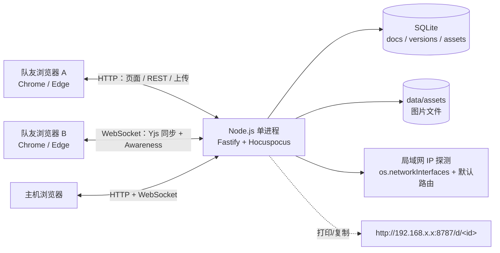
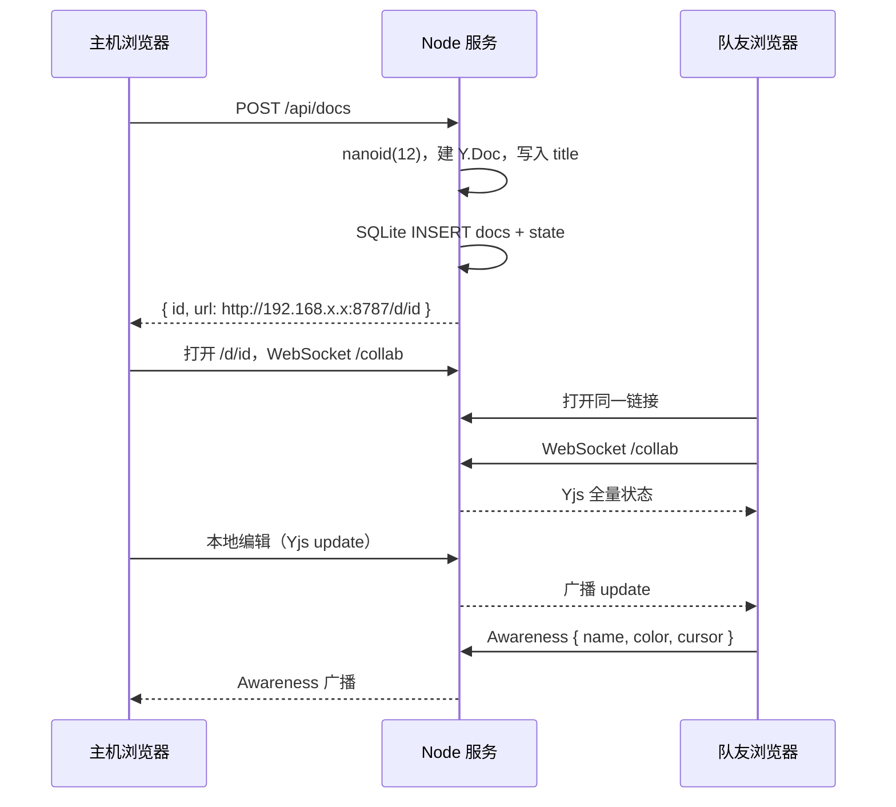

# 局域网题目协作板（LAN Pad）设计方案

> 注：本文是原型阶段（Node.js 后端）的设计调研。当前仓库是 Go 重写版，实现与差异见 [docs/go-rewrite.md](docs/go-rewrite.md)。

> 版本：v1.1  
> 日期：2026-10-26  
> 场景：队内比赛期间，在一台本机启动服务，队友通过局域网链接共同查看、编辑题目信息。  
> 内容形态：**文字 + 代码片段 + 题目截图**为主。  
> 目标：免登录、零配置、单进程、链接即房间；看得见谁在编辑，名字可自定义。  
> 实现状态：v0.1 已按本方案落地，启动方式见 [README.md](README.md)。

---

## 0. 结论先行

**推荐方案：自研一个轻量单进程 Web 应用（约 1,500～2,500 行 TypeScript），核心是 `Yjs + Hocuspocus + Tiptap + SQLite`。**

理由：

- 需求非常聚焦：新建文档、复制局域网链接、多人实时编辑、在线状态与自定义名字；内容以**文字、代码块、截图**为主。
- 现成产品要么太重（Docmost、Outline、OnlyOffice），要么不完整：**Rustpad 是纯文本/代码编辑器，不能贴截图**；Etherpad 的截图/图片能力依赖插件，体验一般；HedgeDoc 要 Postgres。
- Yjs 这一套是成熟的开源协作底座，Hocuspocus 负责 WebSocket 同步和持久化钩子，Tiptap 提供所见即所得编辑器；截图粘贴/上传、代码块高亮都能在编辑器里完成。
- 单进程、一个端口、一个 SQLite 文件，Windows 上 `npm start` 即可；不需要 Docker、Postgres、Redis、账号系统。
- 预计 2.5～4 个工作日可做到可用的 v1（熟练的话 2.5～3 天）；其中截图上传/压缩/灯箱约占半天。

**既然截图是主要内容之一，Rustpad 直接排除；Etherpad 需要图片插件且排版偏旧；自研 Tiptap 是最贴合的选择。**

**如果不想写代码，今天就要用：**

| 诉求 | 推荐现成项目 | 代价 |
|---|---|---|
| 题目**只有文字 + 代码、确定不贴截图** | **Rustpad** | 单 Docker 镜像、MIT、自带自定义名字/颜色/在线列表/分享链接；但纯文本、无图片/表格，默认文档 24 小时过期（可开 SQLite 持久化） |
| 需要富文本、作者颜色、修订历史，截图不多 | **Etherpad + 图片插件** | Apache-2.0、非常成熟；但 UI 较旧、没有原生文档列表，截图/表格依赖插件，链接复制逻辑需要再包一层 |
| 需要 Markdown + 图片 + 多人协作 | HedgeDoc | 功能合适，图片/代码围栏都支持；但要 Postgres，1.x 已进入维护模式、2.0 还在 alpha，部署偏重 |

**按“文字 + 代码 + 截图”逐项看：**

| 能力 | Rustpad | Etherpad | 自研 Tiptap |
|---|---|---|---|
| 文字排版 | 纯文本 | 富文本（较传统） | 富文本，够用 |
| 代码块 | Monaco，强 | 需插件/样式一般 | 代码块 + 语法高亮 + 复制 |
| 截图 | **不支持** | 依赖图片插件 | **粘贴/拖拽上传 + 灯箱** |
| 结论 | 不满足截图需求 | 勉强可用 | **推荐** |

**不建议**为这个场景直接上 Docmost、Outline、AFFiNE、OnlyOffice/Collabora：它们都能做“协作文档”，但需要 Postgres/Redis/对象存储或很大的运行环境，功能也远超“队内比赛题目共享”。

---

## 1. 需求与边界

### 1.1 必须满足

1. 在主机上启动一个服务，最好只有一个命令。
2. 首页可以新建文档，并生成一个**带本机局域网 IP** 的链接。
3. 同一局域网内的其他电脑用浏览器打开链接即可查看、编辑，不需要安装客户端、不需要注册。
4. 实时同步：一个人输入，其他人 1 秒内看到。
5. 显示当前在线的编辑者名字，名字可自定义，并最好有颜色区分。
6. 刷新页面、服务重启后文档还在，截图也不能丢。
7. 支持中文输入法、代码块（保留缩进/语法高亮）、截图粘贴。
8. 截图点击能放大查看，粘贴后不用再走图床/外链。

**需求到设计的映射：**

| 需求 | 对应设计 |
|---|---|
| 本机启动、单服务 | 单 Node 进程、SQLite、`npm start`（§3、§7） |
| 新建文档 | `POST /api/docs` + 首页按钮（§4.2、§5.6） |
| 链接带局域网 IP | 服务端探测网卡 + 首页复制（§4.5） |
| 多人实时编辑 | Yjs + Hocuspocus（§3.4、§5.3、§5.4） |
| 在线名字/自定义 | Awareness + 名字弹窗（§4.4） |
| 刷新/重启不丢 | SQLite 二进制快照 + 版本（§5.2、§5.4） |
| 中文/代码/截图 | Tiptap + 代码块 + 截图上传/灯箱（§4.3、§5.7） |

### 1.2 明确不做（v1）

- 不做账号、密码、组织/空间/权限体系。
- 不做公网访问、HTTPS、域名、反向代理。
- 不做评论、@提醒、任务分配、版本 diff UI。
- 不做 Word/Excel/PPT 格式的在线编辑。
- 不做图片标注/裁剪/OCR/图床；截图只做“粘贴/上传/查看/导出”。
- 不做代码运行/评测，只做代码块的编辑与高亮。
- 不做离线独立 App；断网重连能恢复即可。

### 1.3 一个关键约束：浏览器读不到“电脑名”

浏览器的安全模型不允许网页读取操作系统的计算机名（hostname）。因此“带上编辑的电脑名称”需要落成以下方案：

- **推荐**：首次打开文档时弹窗让用户填一个名字，保存在 `localStorage`，之后自动带上；顶部可随时修改。
- 可以额外显示 **IP 地址**（服务端从连接中获取）作为辅助识别，例如鼠标悬停名字时显示 `192.168.1.34`。
- 如果机房电脑是固定的，可以给每台电脑准备带名字的链接：`http://192.168.1.23:8787/d/<id>?name=红队-01`，第一次打开就自动填好。
- 不建议为了读 hostname 在每台电脑装代理程序，收益很小、部署成本很高。

> 所以产品文案上建议叫“**你的名字 / 座位名**”，而不是“电脑名”；底层仍支持用 `?name=` 预填。

---

## 2. GitHub 开源项目调研

> 数据取自 GitHub API，星标数为约数，时间截至 **2026-10-26**。星标不代表质量，只作为活跃度参考。

### 2.1 候选对比

| 项目 | 类型 | 许可证 | 星标（约） | 实时协作 | 名字/在线状态 | 部署复杂度 | 与本需求匹配度 |
|---|---|---|---:|---:|---|---|---|
| [Etherpad](https://github.com/ether/etherpad) | 富文本协作编辑器 | Apache-2.0 | 18.6k | 强（OT） | 内置作者名/颜色，`?userName=` 可预填 | 中（Node 24 + pnpm 构建；或 Docker） | 高，但 UI 和文档列表偏旧 |
| [Rustpad](https://github.com/ekzhang/rustpad) | 极简代码/文本协作编辑器 | MIT | 4.1k | 强（OT） | 内置名字/颜色/在线用户；名字可改 | 低（6MB Docker 镜像） | 中高，适合纯文本/代码，不适合图文 |
| [HedgeDoc](https://github.com/hedgedoc/hedgedoc) | Markdown 协作笔记 | AGPL-3.0 | 7.5k | 强 | 账号/访客配置相关 | 中高（Docker + Postgres） | 中，功能合适但偏重；1.x 维护模式、2.0 alpha |
| [Docmost](https://github.com/docmost/docmost) | Notion 式协作 Wiki | AGPL-3.0（核心） | 22.1k | 强 | 账号体系 | 高（Postgres + Redis） | 低，功能过剩 |
| [Outline](https://github.com/outline/outline) | 团队知识库 | BSL 1.1 | 41.1k | 强 | 账号体系 | 高（Postgres、Redis、S3 等） | 低，功能过剩且非 OSI 许可 |
| [AFFiNE](https://github.com/toeverything/AFFiNE) | Notion + Miro 式知识库 | 混合/自定义 | 73.8k | 强 | 账号/工作区 | 很高 | 低，过重 |
| [OnlyOffice](https://github.com/ONLYOFFICE/DocumentServer) / [Collabora](https://github.com/CollaboraOnline/online) | 在线 Office 套件 | AGPL-3.0 / 混合 | 7.1k / 3.4k | 强 | 账号体系 | 很高（Document Server、回调、存储） | 很低，不是这个场景 |
| [Yjs](https://github.com/yjs/yjs) | CRDT 协作内核（库） | MIT | 23.0k | 强 | 需自己实现 | 低（作为依赖） | **底座** |
| [Hocuspocus](https://github.com/ueberdosis/hocuspocus) | Yjs WebSocket 后端（库） | MIT | 2.6k | 强 | Awareness 自带 | 低（Node 服务） | **底座** |
| [Tiptap](https://github.com/ueberdosis/tiptap) | 富文本编辑器框架（库） | MIT（核心） | 38.9k | 需接 Yjs | 需自己实现 | 低（前端依赖） | **编辑器** |
| [Diwan](https://github.com/vul-os/diwan) | 单二进制协作办公套件 | MIT/Apache-2.0 | 9 | 强（P2P CRDT） | 账号/邀请 | 低（单二进制） | 理念很接近，但太新，不建议作为比赛基础设施 |

### 2.2 重点项目的实际能力

#### Etherpad

- 非常成熟的实时协作编辑器，Apache-2.0，2009 年至今；最新 release 为 **v3.3.11（2026-10-24）**，仍在维护。
- 内置作者归属：每个按键都记录作者，作者有名字和颜色；支持 `?userName=Alice&userColor=%23ff9900` 这类嵌入参数。
- 有 HTTP API：`createPad`、`listAllPads`、`getReadOnlyID`、`getText`、`getHTML` 等，可以做一个很薄的外壳来新建/列出文档。
- 有完整修订历史（timeslider），对“谁改了什么”很友好。
- 不足：默认 UI 比较传统；没有开箱即用的文档管理界面，列表要自己通过 API 实现；图片、表格等富内容需要插件；默认 DirtyDB 不适合生产，需要换 SQLite/Postgres；安装要 Node 24 + pnpm 构建，或 Docker。
- 结论：**如果接受它的 UI，Etherpad 是最稳的现成方案**，可以加一个 100 行左右的启动页解决“新建文档 + 文档列表 + 局域网链接”。

#### Rustpad

- 定位是“高效、极简、自托管、无需数据库”的协作代码编辑器，MIT，单 6MB Docker 镜像。
- 自带：自定义名字、颜色、在线用户列表、分享链接、语言选择、SQLite 可选持久化。
- 源码里名字就是 `localStorage` + 在线用户列表，和我们的“自定义名字”需求几乎一致；分享链接也是 `window.location.origin + '/#' + id`。
- 不足：Monaco 是纯文本/代码编辑器，**不能贴图**、不能富文本、不能表格；没有首页文档列表；默认文档 24 小时不活跃就回收；项目最近一次推送是 2025-02，活跃度一般。
- 结论：**如果题目只有文字 + 代码、确定不贴截图，Rustpad 是性价比最高的“零开发”选择**；只要把分享链接改成局域网 IP，并注意开 SQLite 持久化即可。**有截图就不要选它。**

#### HedgeDoc / Docmost / Outline

- HedgeDoc：Markdown 实时协作很好用，但官方 Docker 方案需要 Postgres；README 明确说 1.x 进入 maintenance-only，2.0 还是 alpha。适合“愿意维护一套服务”的团队，不适合“本机临时开一场比赛”。
- Docmost：Notion 式 Wiki，功能很全，但 docker-compose 里同时有 Postgres 和 Redis；账号、空间、权限都不是我们需要的。
- Outline：BSL 1.1（不是 OSI 开源许可），生产部署通常还要 Postgres、Redis、S3；功能过剩，许可也需要额外确认。
- 结论：**不作为首选**。如果队伍已经有这些服务，可以直接用；否则没必要为一个小场景引入整套基础设施。

#### Yjs / Hocuspocus / Tiptap

- Yjs 是 CRDT 协作内核，MIT；文档状态必须存成二进制 `Uint8Array`，不能存 JSON 再重建，否则会出现重复内容。
- Hocuspocus 是 Yjs 的 WebSocket 后端，MIT，当前 4.x；提供 `onLoadDocument` / `onStoreDocument` 持久化钩子、Awareness（在线状态）、只读连接、认证钩子等。
- Tiptap 是基于 ProseMirror 的富文本编辑器，核心 MIT；`@tiptap/extension-collaboration` 和 `@tiptap/extension-collaboration-caret` 都是 MIT，可以直接接 Yjs。
- 结论：**这是“自研轻量版”最合适的底座**，不用自己实现 OT/CRDT、重连、光标同步。

### 2.3 选型结论

| 路线 | 开发量 | 优点 | 缺点 | 建议 |
|---|---:|---|---|---|
| 自研 Yjs 单进程应用 | 2.5～3.5 人日 | 完全贴合需求，单端口、单文件、UI 可控 | 需要写代码、需要测中文输入/重连 | **推荐** |
| Etherpad + 薄外壳 | 0.5～1 人日 | 最成熟，作者颜色/历史完善 | UI 旧、图片/表格弱、两套进程/端口 | 时间优先时选 |
| Rustpad 直接用/小改 | 0.5 人日 | 极简、单镜像、名字/在线列表现成 | 纯文本、**无截图**、文档列表弱 | 仅文字+代码、无截图时选 |
| Docmost / Outline / OnlyOffice | 1 人日以上 | 功能全 | 太重、账号体系、维护成本高 | 不推荐 |

> 下面详细展开**自研方案**。如果你决定走 Etherpad/Rustpad，我也可以按同样的结构给一份“部署 + 薄外壳”的落地方案。

---

## 3. 推荐方案总览

### 3.1 一句话

**一个 Node.js 单进程服务：HTTP 提供页面和 API，WebSocket 承载 Yjs 同步；文档状态和元数据存 SQLite，图片存本地目录；首页负责新建/列表/复制局域网链接，文档页负责编辑和在线状态。**

### 3.2 技术栈

| 层 | 选型 | 说明 |
|---|---|---|
| 运行时 | Node.js 22.12+ / 24 LTS | Hocuspocus 4 要求 Node ≥ 22；Vite 8 要求 ≥ 22.12 |
| 服务端 | Fastify（或 Express） | 轻量、TypeScript 友好；负责静态文件、REST、上传 |
| 实时协作 | Hocuspocus 4 + Yjs 13 | WebSocket 同步、Awareness、持久化钩子 |
| 编辑器 | React 19 + Tiptap 3 | 富文本；代码块、截图、表格、链接、灯箱 |
| 构建 | Vite + TypeScript | 前端构建；产物由 Node 静态托管 |
| 存储 | `node:sqlite`（Node 22.5+，实测 22.22） | 零原生依赖；WAL 模式；一个 `.db` 文件 |
| 截图/图片 | 本地文件 + SQLite 元数据 | 内容寻址，按 SHA-256 命名；灯箱查看 |
| 样式 | Tailwind CSS 或原生 CSS | 不引入重型 UI 库，保持简单 |

> 如果 `node:sqlite` 在当前 Node 小版本上仍有警告，可换成 `better-sqlite3`；接口几乎一样，但 Windows 上可能需要预编译包/构建工具。Node 22/24 的 `node:sqlite` 目前仍标记为 experimental，内部工具够用；如果你更看重长期稳定，直接用 `better-sqlite3` 也可以。

### 3.3 架构图



### 3.4 为什么用 CRDT，而不是锁或 OT

- **不加锁**：比赛时需要多人同时补充题目，锁会让体验很差。
- **Yjs CRDT**：每个人本地先改，再合并；断网/卡顿后恢复也能合并；服务端只负责转发和持久化，逻辑简单。
- **OT（Etherpad/ShareDB）**：也很成熟，但需要服务端做操作变换；自己实现成本高。用 Etherpad 就直接用它，不需要自己写 OT。
- 本方案用 Yjs，不重复造轮子。

---

## 4. 产品设计

### 4.1 页面与流程

```text
首页 /
  ├─ 显示本机局域网地址（可切换网卡）
  ├─ [+ 新建文档]
  ├─ 文档卡片列表：标题 / 最近活跃 / 时间 / 在线人数
  └─ 每张卡片：[打开] [复制链接] [更多]

文档页 /d/:id
  ├─ 顶部：返回、可编辑标题、在线头像、连接状态、[分享]、[导出]
  ├─ 正文：Tiptap 富文本编辑器
  ├─ 首次进入：名字弹窗（可跳过，默认“队员-xx”）
  └─ 分享弹窗：局域网链接 + 复制 + 可选二维码

只读页 /d/:id?mode=view
  └─ 隐藏工具栏，编辑器设为不可编辑（v1 仅 UI 约束；真正的只读见 6.3）
```

### 4.2 首页

```text
┌──────────────────────────────────────────────────────────────┐
│  LAN Pad · 队内题目协作         本机：192.168.1.23:8787 [复制]│
├──────────────────────────────────────────────────────────────┤
│  [+ 新建文档]   [搜索标题...]                                │
│                                                              │
│  ┌────────────────────────────┐  ┌────────────────────────┐  │
│  │ A题 · 图论                 │  │ B题 · 动态规划         │  │
│  │ 张三 · 2 分钟前   ● 3 人在线│  │ 李四 · 10 分钟前 ● 1 人│  │
│  │ [打开] [复制链接]          │  │ [打开] [复制链接]      │  │
│  └────────────────────────────┘  └────────────────────────┘  │
└──────────────────────────────────────────────────────────────┘
```

- 新建后直接进入文档页，标题默认“未命名文档”，正文空。
- 文档卡片按 `updated_at` 倒序；在线人数来自 Hocuspocus 连接计数。
- “复制链接”永远用**服务端返回的局域网地址**，不用 `window.location.origin`（避免主机用 `localhost` 打开时复制出 `localhost` 链接）。
- 首页显示“本机地址”下拉框：检测到多个网卡（Hyper-V、WSL、VPN、虚拟网卡）时，让主机选队友能访问的那个。
- 空状态给一句提示：“把链接发到群里，队友打开就能一起写。”
- 删除文档时若有人在线，先提示主机确认；确认后关闭该文档的 WebSocket 连接，再软删除。

### 4.3 文档页

- 顶部标题是可编辑输入框，绑定 Yjs 的 `Y.Text('title')`，所有人可改。
- 在线状态：彩色圆点 + 名字；名字过长省略；悬停显示 IP；相同名字在列表里加短后缀区分（不修改用户输入）。
- 连接状态：`已连接` / `重连中` / `离线`；离线时编辑不丢，恢复后自动合并。
- 工具栏保持克制：标题、加粗/斜体/删除线、列表、引用、代码块、行内代码、链接、表格、截图、撤销/重做。
- 右下角显示字数、保存状态；`Ctrl/Cmd+S` 只是提示“已自动保存”，不需要真的保存。
- **文字**：标题、段落、列表、引用、加粗/斜体即可；不追求 Word 级排版。
- **代码块**：支持语言选择（C++ / Python / Java / Rust / JavaScript 等）、保留缩进、等宽字体、语法高亮、一键复制；输入法不要自动替换引号/破折号。
- **截图**：支持 `Ctrl+V` 粘贴、拖拽、点击按钮选择文件；上传后插入正文，默认宽度适应页面，点击图片打开灯箱放大；可填写一句图片说明。
- **混合粘贴**：从微信/QQ/Word 粘贴“文字 + 图片”时，文字按 Tiptap schema 插入，图片自动走上传接口，**不能把 base64 直接塞进 Yjs 文档**。
- **题目模板（可选）**：新建时选“题目模板”，预置“题目描述 / 输入输出 / 样例 / 题解 / 截图”几个段落，减少现场排版时间。
- 表格：适合放样例、复杂度对比。
- 公式（可选）：KaTeX 行内/块级公式；如果比赛题目有数学公式，建议加。
- 导出：Markdown、HTML；打印为 PDF 走浏览器打印；导出的 HTML/Markdown 要包含图片链接。

### 4.4 名字与在线状态

**首次进入：**

```text
┌──────────────────────────────┐
│  先给自己起个名字            │
│  [ 张三                  ]   │
│  这个名字会显示给同文档的人  │
│  [稍后再说]      [开始编辑]  │
└──────────────────────────────┘
```

规则：

- 1～24 个字符，允许中文、英文、数字、空格、常见 emoji。
- 去掉首尾空格，禁止控制字符和 HTML 标签。
- 默认值：`队员-` + 2 位随机数；如果链接带 `?name=`，优先用它。
- 保存到 `localStorage["lanpad.name"]`；换文档不用重复填。
- 顶部头像/名字可点击修改，修改后立即通过 Awareness 广播。
- 颜色从固定调色板按 `clientId` 分配，保证同一个人刷新后颜色尽量稳定（可把颜色也存 localStorage）。
- 空闲 5 分钟显示“离开”状态（可选）；关闭页面后 Awareness 超时自动移除。

**显示内容：**

- 头像圆点：名字首字/首字母。
- 名字：`张三`，自己显示 `张三（你）`。
- 悬停：`192.168.1.34 · 正在编辑`。
- 远端光标：彩色竖线 + 名字标签；选区用半透明颜色。
- 在线列表最多显示 6 个，超出显示 `+N`，点开看全部。

> 实现：`provider.setAwarenessField('user', { name, color, ip })`；光标用 Tiptap 的 `CollaborationCaret`（MIT）或 `y-prosemirror` 的 `yCursorPlugin`。改名字时调用 `editor.commands.updateUser({ name, color })`，否则编辑器里的光标标签不会立刻更新。

### 4.5 分享链接与局域网 IP

链接格式：

```text
http://192.168.1.23:8787/d/7f3k9q2m1x8a
```

可选参数：

```text
?name=红队-01     首次打开预填名字（适合固定机房）
?mode=view        只读查看（v1 仅 UI 约束）
```

**IP 选择逻辑（重点）：**

1. 服务启动时枚举 `os.networkInterfaces()`。
2. 只保留 IPv4、非内网回环、私有地址（`10/8`、`172.16/12`、`192.168/16`）。
3. 用 UDP socket “连接”一个公网地址（不会真的发包）拿到默认出口 IP，作为推荐项：

   ```ts
   const socket = dgram.createSocket('udp4')
   socket.connect(53, '223.5.5.5', () => {
     const ip = socket.address().address
     socket.close()
   })
   ```

4. 同时返回所有候选地址（带网卡名），首页下拉可切换；选择结果存 `localStorage`。如果 UDP 探测失败（没有默认路由/防火墙限制），回退到第一个私有 IPv4。
5. 如果自动推荐不对，允许在 `.env` 里写死 `PUBLIC_BASE_URL=http://192.168.1.23:8787`。
6. 复制按钮使用 `GET /api/network` 返回的 `primary`，**绝不使用 `localhost`/`127.0.0.1`**。
7. 启动日志同时打印：

   ```text
   本机访问:   http://localhost:8787
   局域网访问: http://192.168.1.23:8787
   如队友打不开，请检查 Windows 防火墙是否放行 8787 端口。
   ```

> 不建议依赖 mDNS（`主机名.local`）：Windows/公司网络/手机支持不一致，IP 最可靠。二维码可以作为锦上添花，不替代 IP。

### 4.6 “查看”与“只读”

- 默认所有拿到链接的人都可以编辑；这符合“队内共享”的信任模型。
- `?mode=view` 只是前端把编辑器设为 `editable=false` 并隐藏工具栏，**不是安全边界**；懂技术的人可以改 URL 去掉参数。
- 如果确实需要“评委只能看、不能改”，在 v1.5 加**签名只读链接**：
  - 分享时服务端生成 `token = HMAC(docId + mode + exp, SECRET)`。
  - Hocuspocus `onAuthenticate` 校验 token，设置 `connection.readOnly = true`。
  - 这样即使改 URL 也改不了内容。
- 比赛内部使用，建议先做 UI 只读，别过早引入 token 复杂度。

---

## 5. 技术设计

### 5.1 进程与端口

- 一个 Node 进程，默认监听 `0.0.0.0:8787`。
- HTTP 与 WebSocket 共用 8787：
  - `/api/*`：REST。
  - `/assets/*`：图片。
  - `/d/*`、`/`：前端页面（SPA fallback）。
  - `/collab`：WebSocket upgrade，交给 Hocuspocus。
- 如果 Hocuspocus v4 的 `handleConnection` 同端口集成遇到问题，退化为 WS 单独监听 `8788`；前端用 `location.hostname` 自动拼 `ws://host:8788`。架构不变，只是多开一个防火墙端口。
- 同端口挂载时不要调用 Hocuspocus 的 `listen()`；按官方 Express 示例，用 `crossws` 的 `open` / `message` / `close` 钩子分别调用 `handleConnection` / `handleMessage` / `handleClose`。

### 5.2 数据模型

SQLite，开启 WAL：

```sql
PRAGMA journal_mode = WAL;
PRAGMA synchronous = NORMAL;
PRAGMA busy_timeout = 5000;

CREATE TABLE IF NOT EXISTS docs (
  id          TEXT PRIMARY KEY,          -- nanoid(12)
  title       TEXT NOT NULL DEFAULT '未命名文档',
  state       BLOB,                      -- Y.encodeStateAsUpdate
  created_at  INTEGER NOT NULL,
  updated_at  INTEGER NOT NULL,
  created_by  TEXT,
  last_editor TEXT,                       -- 最近活跃者（展示用）
  last_version_at INTEGER NOT NULL DEFAULT 0,
  deleted_at  INTEGER                    -- 软删除，进回收站
);

CREATE TABLE IF NOT EXISTS versions (
  id         INTEGER PRIMARY KEY AUTOINCREMENT,
  doc_id     TEXT NOT NULL,
  state      BLOB NOT NULL,
  title      TEXT,
  created_at INTEGER NOT NULL
);
CREATE INDEX IF NOT EXISTS idx_versions_doc ON versions(doc_id, created_at DESC);

CREATE TABLE IF NOT EXISTS assets (
  id         TEXT PRIMARY KEY,
  doc_id     TEXT NOT NULL,
  sha256     TEXT NOT NULL,
  filename   TEXT NOT NULL,
  mime       TEXT NOT NULL,
  size       INTEGER NOT NULL,
  width      INTEGER,
  height     INTEGER,
  created_at INTEGER NOT NULL,
  UNIQUE(doc_id, sha256)
);
CREATE INDEX IF NOT EXISTS idx_assets_doc ON assets(doc_id);

CREATE TABLE IF NOT EXISTS settings (
  key   TEXT PRIMARY KEY,
  value TEXT NOT NULL
);
```

- 文档 ID 用 `nanoid(12)`，字母表限定小写字母 + 数字（`customAlphabet('0123456789abcdefghijklmnopqrstuvwxyz', 12)`），不可顺序猜测；不要用标题做 ID。
- 标题既存在 `docs.title`（列表用），也存在 `Y.Text('title')`（协作编辑用）；`onStoreDocument` 时同步。**标题的修改只走 Yjs，不另开 REST 改名接口**，避免两个写入源打架。
- 图片文件路径：`data/assets/<docId>/<sha256>.<ext>`；数据库只存元数据。
- 软删除：`deleted_at` 不为空则首页不显示；回收站保留 7 天，之后清理。
- `last_editor` 从最近一次 Awareness 中的用户名取，仅作“最近活跃”展示，不追求审计级精确。
- 在线人数用 Hocuspocus `connected` / `onDisconnect` 钩子按 docId 计数，不落库。

### 5.3 Yjs 文档结构

```text
Y.Doc
├─ Y.Text("title")          // 文档标题，多人可改
└─ Y.XmlFragment("content") // Tiptap/ProseMirror 正文
```

Tiptap 配置要点：

```ts
const ydoc = new Y.Doc()

useEditor({
  extensions: [
    StarterKit.configure({ undoRedo: false }), // 历史交给 Yjs
    Collaboration.configure({
      document: ydoc,
      field: 'content',
    }),
    CollaborationCaret.configure({
      provider,
      user: { name, color },
    }),
    Table.configure({ resizable: true }),
    Image.configure({ inline: false }),
    CodeBlockLowlight.configure({ lowlight }),
    // Link、Placeholder、KaTeX 按需
  ],
})
```

注意事项：

- **不要启用 Tiptap 自带的 UndoRedo**，否则和 Yjs 的撤销冲突；Collaboration 扩展已经内置 Yjs 撤销，工具栏调用 `editor.commands.undo()` / `redo()` 即可。
- 标题输入框不要每次按键 `delete(0, len) + insert` 整个字符串，容易让远端光标跳动；用 diff 更新，或接受标题的轻微跳动（正文不受影响）。
- 中文输入法组合期间不要做额外 transaction 操作；Tiptap/Yjs 默认能处理，但必须实测。

### 5.4 持久化

Hocuspocus 的钩子：

```ts
import { Hocuspocus } from '@hocuspocus/server'
import * as Y from 'yjs'
import { Database } from 'node:sqlite'

const db = new Database('data/lanpad.db')
db.exec('PRAGMA journal_mode = WAL;')

const hocuspocus = new Hocuspocus({
  debounce: 1000,
  maxDebounce: 5000,

  async onLoadDocument({ documentName }) {
    const row = db.prepare('SELECT state FROM docs WHERE id = ?').get(documentName) as
      | { state: Uint8Array | null }
      | undefined
    const doc = new Y.Doc()
    if (row?.state) Y.applyUpdate(doc, row.state)
    return doc
  },

  async onStoreDocument({ documentName, document }) {
    const state = Y.encodeStateAsUpdate(document)
    const title = document.getText('title').toString() || '未命名文档'
    const now = Date.now()

    db.prepare(
      `UPDATE docs SET state = ?, title = ?, updated_at = ? WHERE id = ?`
    ).run(state, title, now, documentName)

    // 每 5 分钟留一个版本；每个文档最多保留 50 个
    // （实际实现里用 settings 表记录 last_version_at，避免每次写版本）
  },
})

// HTTP upgrade 时交给 Hocuspocus，见官方 handleConnection 示例
```

必须遵守：

- **Yjs 状态必须存二进制**，不能存 JSON 再重建；否则合并会重复内容（Hocuspocus 官方明确警告）。
- `onStoreDocument` 是防抖的；正常关闭时调用 `server.destroy()` / `flushPendingStores()`，确保最后一批内容落盘。
- 崩溃最多丢 1～5 秒；客户端还开着的话，重连后会把缺失更新补回来。
- SQLite 单文件便于备份；不要把数据库放在 OneDrive 同步目录里（锁文件容易冲突）。

### 5.5 REST API

| 方法 | 路径 | 作用 |
|---|---|---|
| `GET` | `/api/health` | 健康检查：`{ ok, uptime, docs, connections }` |
| `GET` | `/api/network` | 返回 `{ primary, addresses: [{ iface, address }] }` |
| `GET` | `/api/docs` | 文档列表（不含已删除） |
| `POST` | `/api/docs` | 新建，body `{ title? }`，返回 `{ id, url }` |
| `GET` | `/api/docs/:id` | 文档元数据 |
| `DELETE` | `/api/docs/:id` | 软删除；需要主机密钥 |
| `POST` | `/api/docs/:id/assets` | 上传图片（multipart），返回 `{ url }` |
| `GET` | `/api/docs/:id/export?format=md`（或 `html`） | 导出 |
| `GET` | `/api/docs/:id/versions` | 版本列表（主机密钥） |
| `POST` | `/api/docs/:id/restore` | 恢复版本（主机密钥） |

> 标题和正文都通过 Yjs 同步；REST 只负责“文档生命周期”和“图片/导出”，不参与正文写入。

WebSocket：

```text
ws://192.168.1.23:8787/collab
```

Hocuspocus 的文档名通过协议里的 `name` 字段传递（provider 配置 `name: docId`），不需要在 URL 里再拼一个查询参数。

错误格式统一：

```json
{ "error": { "code": "DOC_NOT_FOUND", "message": "文档不存在" } }
```

### 5.6 新建文档的流程



### 5.7 截图、代码块与导出

**截图/图片上传（核心链路）：**

1. 监听编辑器 `paste` / `drop` / 文件选择；从 `clipboardData.items` 或 `DataTransfer.files` 里取图片文件。
2. 客户端先做尺寸/大小检查：原图超过 25MB 直接拒绝；宽度超过 2560px 的截图等比缩小；截图优先保持 PNG（文字清晰），照片可转 WebP/JPEG；缩小后仍超过 10MB 的 PNG 转 WebP 0.9，仍超限则提示裁剪。
3. 用 `FormData` 上传到 `POST /api/docs/:id/assets`；上传期间显示占位 skeleton，失败保留重试按钮。
4. 服务端接收 `multipart/form-data`，字段名 `file`；限制 10MB、像素上限 40MP；只允许 PNG/JPEG/WebP/GIF；**禁止 SVG**。
5. 读取文件头校验真实类型，不只看扩展名；计算 SHA-256，按内容寻址存 `data/assets/<docId>/<sha256>.<ext>`；同一文档内重复图片去重。
6. 返回 `{ url: "/assets/<docId>/<sha256>.png", width, height }`；前端插入 Tiptap `image` 节点，设置 `alt` 和默认宽度。
7. 静态响应加 `X-Content-Type-Options: nosniff`、`Cache-Control: public, max-age=31536000, immutable`；只返回白名单 MIME。
8. 点击图片打开灯箱（原图/适应屏幕切换）；按 `Esc` 关闭；移动端支持双指缩放。

**粘贴 HTML 里的图片：**

- 从微信/QQ/Word 粘贴时，HTML 里可能出现 `` 或本地临时路径。
- 用 `editorProps.handlePaste` 拦截：先把 `` 的 `src` 转成 `Blob` 上传，再把 `src` 替换成 `/assets/...`，最后交给 Tiptap 插入。
- Tiptap `Image.configure({ allowBase64: false })`，从根上禁止 base64 进文档。

**代码块：**

- 用 `CodeBlockLowlight` + `lowlight`，注册常用语言；语言下拉至少包含 C++、Python、Java、Rust、JavaScript、Go、Plain Text。
- 代码块内关闭智能标点/自动替换；保留空格和换行；右下角提供“复制代码”。
- 支持从剪贴板粘贴多行代码时自动进入代码块（可选）；至少保证粘贴到已有代码块内不丢缩进。

**图片尺寸建议（给用户的提示）：**

- 只截题目/样例/报错的关键区域，不要整屏 4K；宽度 1600～2560 足够。
- 代码尽量用代码块而不是代码截图，方便队友复制、搜索、改错。
- 截图里如果含账号、内网地址等敏感信息，先打码再传。

**导出：**

- Markdown：把 ProseMirror JSON 转 Markdown；图片用 `/assets/...` 绝对 URL，或打包成 zip（v2）。
- HTML：用 Tiptap 的 `generateHTML`，再做一次白名单清洗；不要直接拼接用户 HTML；图片链接改绝对地址，方便离线打开。
- PDF：浏览器打印；中文环境没问题，不需要服务端 LibreOffice；打印样式隐藏工具栏和在线头像。

### 5.8 网络地址探测

```ts
import os from 'node:os'
import dgram from 'node:dgram'

function privateIPv4s() {
  const out: { iface: string; address: string }[] = []
  for (const [iface, list] of Object.entries(os.networkInterfaces())) {
    for (const item of list ?? []) {
      if (item.family !== 'IPv4' || item.internal) continue
      if (!/^(10\.|192\.168\.|172\.(1[6-9]|2\d|3[01])\.)/.test(item.address)) continue
      out.push({ iface, address: item.address })
    }
  }
  return out
}

function defaultRouteIPv4(): Promise<string | null> {
  return new Promise((resolve) => {
    const socket = dgram.createSocket('udp4')
    socket.once('error', () => { socket.close(); resolve(null) })
    socket.connect(53, '223.5.5.5', () => {
      const ip = socket.address().address
      socket.close()
      resolve(ip)
    })
  })
}
```

排序规则：

1. 默认路由 IP 优先。
2. 物理网卡（名字含 `Wi-Fi`、`Ethernet`、`WLAN`）优先于 `vEthernet`、`VMware`、`VirtualBox`、`Tailscale`。
3. 其余按私有地址排序。
4. 首页显示全部候选，默认选中第一个；选择结果存 localStorage。

### 5.9 断线、重连、错误处理

- Hocuspocus provider 自带指数退避重连；UI 显示“重连中”，不要弹破坏性的错误框。
- 服务端重启：客户端重连后做 Yjs sync，未落盘的本地更新会补上。
- WebSocket 断开期间，编辑器仍可输入；顶部显示“离线编辑，恢复后自动同步”。
- 可选：用 `y-indexeddb` 做本地缓存，这样断网时刷新页面也能恢复；v1 可不做，避免增加复杂度。
- 如果文档不存在：显示“文档不存在或已被删除”，提供返回首页。
- 如果上传失败：保留本地图片预览，提示重试；不要静默丢弃。
- 多张截图同时粘贴时，上传队列并发限制为 2，避免把主机上行带宽打满；失败的图片可以单张重试。
- 如果文档状态超过 5MB：提示“文档过大，请拆分”，避免拖垮浏览器。
- 所有 API 请求加 10 秒超时；错误统一 toast。

---

## 6. 安全设计

### 6.1 威胁模型

这是**局域网内部工具**，不是公网产品。主要风险不是黑客，而是：

- 同一 Wi-Fi 下的其他人误入/恶作剧。
- 队友误删文档、误粘贴敏感信息。
- 图片上传/HTML 粘贴导致的 XSS。
- 主机把端口映射到公网，导致意外暴露。

### 6.2 措施

| 风险 | 措施 |
|---|---|
| 链接被猜到 | 文档 ID 用 `nanoid(12)`，不可顺序枚举；首页只在内网可达 |
| 误删 | 删除为软删除，进回收站 7 天；删除接口需要主机密钥 |
| 误改 | Yjs 多人合并 + 撤销；版本快照可恢复 |
| XSS | Tiptap schema 白名单；链接只允许 `http/https/mailto`；不用 `dangerouslySetInnerHTML`；导出 HTML 再清洗；禁止 SVG |
| 恶意上传 | 10MB 限制、40MP 像素上限、MIME 白名单、文件头校验、随机文件名、独立 `/assets` 路径、`nosniff`、CSP `img-src 'self' data: blob:` |
| 路径穿越 | 资源路径只接受 `docId` + `sha256`，服务端拼路径前校验正则；不接受用户传相对路径 |
| 资源滥用 | 限流：新建 10 次/分/IP，上传 20 次/分/IP；单文档 5MB 文本、500MB 资源；总文档数上限 500 |
| 公网暴露 | 默认绑定 `0.0.0.0` 但文档/启动日志明确“仅局域网”；防火墙规则限制 `LocalSubnet`；不要做端口映射 |
| 权限 | v1 无账号；如需访问码，见 6.3 |

**主机密钥：**

- 首次启动生成 32 字节随机 hex，保存到 `data/host-key.txt`，并打印到控制台。
- 删除、恢复版本等破坏性 API 要求 `X-Host-Key`。
- 首页“主机操作”第一次点击时让主机输入一次密钥，存 `sessionStorage`；不输入则隐藏删除按钮。
- 这样普通队友不会误删，但不需要完整账号系统。

### 6.3 可选增强：访问码 / 签名只读

如果比赛场地是公共机房，或者不想让同网段任何人看到首页：

**访问码：**

- `.env` 设置 `ACCESS_CODE=xxx`。
- 未登录时显示一个简单的访问码输入页。
- 校验通过后设置 `HttpOnly; SameSite=Lax` 的签名 cookie。
- Hocuspocus `onAuthenticate` 校验 cookie；REST 中间件同样校验。
- 这不改变“无账号”的体验，只是在入口加一道门。

**签名只读链接：**

- `POST /api/docs/:id/share` 生成 `?t=<HMAC>`，payload 含 `docId`、`mode=view`、`exp`。
- `onAuthenticate` 校验后 `connection.readOnly = true`，服务端拒绝写更新。
- 适合裁判/围观，不适合默认开启。

> 建议 v1 先不做，等确认有“外人能进内网”的风险再加。安全措施要和比赛现场的实际网络环境匹配。

---

## 7. 部署与运维

### 7.1 环境

- Windows 10/11（主机），Node.js **22.12+**（推荐 24 LTS）。
- 队友只需要 Chrome / Edge / Firefox 等现代浏览器。
- 主机和队友在同一网段；关闭路由器的“AP 隔离/客户端隔离”。

### 7.2 启动

```bash
# 首次
npm ci
npm run build

# 启动
npm start
```

`package.json`：

```json
{
  "scripts": {
    "dev": "concurrently \"vite\" \"tsx watch server/index.ts\"",
    "build": "vite build && tsc -p tsconfig.server.json",
    "start": "node dist/server/index.js"
  }
}
```

`.env`：

```ini
PORT=8787
HOST=0.0.0.0
DATA_DIR=./data
# PUBLIC_BASE_URL=http://192.168.1.23:8787
# ACCESS_CODE=
```

`start.bat`（双击启动，自动开浏览器）：

```bat
@echo off
cd /d "%~dp0"
if not exist node_modules (
  echo 首次运行，正在安装依赖...
  call npm ci
)
if not exist dist (
  echo 首次运行，正在构建...
  call npm run build
)
start "" http://localhost:8787
node dist\server\index.js
pause
```

### 7.3 Windows 防火墙

首次启动时 Windows 可能弹出“是否允许 Node.js 访问网络”，勾选**专用网络**。如果没有弹窗或队友打不开，用管理员 PowerShell 加一条只允许本地子网的规则：

```powershell
New-NetFirewallRule `
  -DisplayName "LAN Pad 8787" `
  -Direction Inbound `
  -Protocol TCP `
  -LocalPort 8787 `
  -Action Allow `
  -Profile Private `
  -RemoteAddress LocalSubnet
```

或：

```bat
netsh advfirewall firewall add rule name="LAN Pad 8787" dir=in action=allow protocol=TCP localport=8787 remoteip=LocalSubnet profile=private
```

> 如果当前网络被 Windows 识别为“公用网络”，上面的 `-Profile Private` 规则不会生效；把网络改为“专用”，或临时把规则改成 `-Profile Any`（确认现场网络可信后再这么做）。

验证：

```powershell
# 在队友电脑上
Test-NetConnection 192.168.1.23 -Port 8787
# 或浏览器打开
http://192.168.1.23:8787/api/health
```

打不开的排查顺序：

1. 两台电脑是否同一网段（`ipconfig` 对比前三位）。
2. 能否 `ping 192.168.1.23`。
3. 主机防火墙是否放行 8787（专用网络）。
4. 是否连了 VPN / 虚拟机网卡，选错 IP。
5. 路由器是否开了 AP 隔离/客户端隔离。
6. 公司 Wi-Fi 是否禁止终端互访（换手机热点/交换机测试）。

### 7.4 数据与备份

```text
data/
├─ lanpad.db          # SQLite（文档、版本、资源元数据）
├─ host-key.txt       # 主机密钥
├─ assets/
│  └─ <docId>/
│     └─ <sha256>.png
├─ backups/
│  └─ lanpad-20261026-1030.db
└─ logs/
   └─ app.log
```

- 每天/每次启动做一次 `VACUUM INTO 'data/backups/lanpad-YYYYMMDD-HHmmss.db'`，保留最近 10 份。
- 比赛结束后，把整个 `data/` 目录复制走即可；不需要导出数据库。
- 恢复：停服务，替换 `lanpad.db`，启动。
- 不要把 `data/` 放在 OneDrive/坚果云同步目录；SQLite WAL 文件会被同步工具锁住/损坏。

### 7.5 日志

- 控制台 + `data/logs/app.log`（按天轮转）。
- 记录：启动、文档创建/删除、上传失败、WebSocket 错误、未捕获异常。
- **不记录文档正文**；只记录 docId、IP、耗时、错误码。
- 健康检查：`GET /api/health` 返回进程、文档数、当前连接数、数据库状态。

---

## 8. 测试与验收

### 8.1 自动化

- 单元：IP 筛选/排序、ID 生成、标题校验、路径校验、Markdown/HTML 导出。
- 集成：两个 Yjs 客户端连接同一文档，A 输入后 B 收到；断线重连；服务重启后内容还在；上传图片后 URL 可访问；只读 token 拒绝写入。
- E2E（Playwright）：两个 browser context 打开同一链接，输入中文，断言两边文本一致；刷新；改名；删除。

### 8.2 手动测试清单

- [ ] 主机用 `localhost` 打开，复制出的链接是 `http://192.168.x.x:8787/...`，不是 localhost。
- [ ] 队友电脑能打开链接，能看到已有内容。
- [ ] 两人同时输入不同段落，内容都保留，不互相覆盖。
- [ ] 中文输入法连续输入、候选词选择、emoji 正常。
- [ ] 从微信/QQ 截图粘贴，图片上传并显示；刷新后还在；点击能灯箱放大。
- [ ] 4K/超 10MB 截图有压缩或明确提示，不会把页面卡死。
- [ ] 代码块保留缩进，语言高亮和“复制代码”正常。
- [ ] 粘贴 Word/网页内容，格式基本保留且没有脚本。
- [ ] 代码块、表格、链接正常；导出 Markdown/HTML 可打开。
- [ ] 修改名字，其他人 1 秒内看到新名字和颜色。
- [ ] 关闭一个标签页，在线列表移除；刷新后名字/颜色保留。
- [ ] 服务重启，文档内容还在；客户端自动重连。
- [ ] 5～10 个客户端同时编辑不卡顿；CPU/内存正常。
- [ ] 文档删除进回收站，7 天内可恢复。
- [ ] 非主机无法调用删除接口（无 host key 返回 403）。

### 8.3 验收标准

1. 主机执行 `npm start`，控制台打印可用的局域网 URL。
2. 任意队友电脑 30 秒内打开链接并开始编辑，无需安装/注册。
3. 两端输入延迟 < 1 秒（同一局域网）。
4. 在线名单显示自定义名字，改名实时生效。
5. 刷新/重启不丢文档；图片不丢。
6. 复制出的链接不含 `localhost`。
7. 连续使用 2 小时无崩溃、无明显内存增长。

---

## 9. 排期与工作量

按 1 名熟悉 TypeScript/React 的开发估算：

| 阶段 | 内容 | 工作量 |
|---|---|---|
| D1 上午 | 脚手架、Fastify、SQLite schema、文档 CRUD、首页 | 0.5 天 |
| D1 下午 | Hocuspocus + Yjs + Tiptap 接入，双端同步跑通 | 0.5 天 |
| D2 上午 | 名字弹窗、Awareness、在线列表、远端光标、标题同步 | 0.5 天 |
| D2 下午 | 截图粘贴/压缩/上传/灯箱、代码块、表格、导出、错误/重连状态 | 0.5～0.75 天 |
| D3 上午 | 局域网 IP、复制链接、防火墙、部署脚本 | 0.5 天 |
| D3 下午 | 双机/多端测试、中文输入、边界情况、备份 | 0.5 天 |
| 缓冲 | 兼容性/现场问题 | 0.5～1 天 |
| **合计** |  | **3～4 天（熟练 2.5～3 天）** |

如果退化到“纯文本 + 名字 + 链接”，可以压缩到 **1.5～2 天**；如果加公式、只读 token、版本恢复 UI，再加 1 天。

---

## 10. 风险与对策

| 风险 | 影响 | 对策 |
|---|---|---|
| 公司 Wi-Fi 开了客户端隔离 | 队友打不开 | 提前用手机/另一台电脑测；改用手机热点或小交换机 |
| Windows 防火墙拦截 | 链接超时 | 首次允许“专用网络”；提供 `New-NetFirewallRule` 命令 |
| 多网卡/VPN 选错 IP | 链接不可达 | 首页显示所有候选，默认路由优先，可手动切换 |
| 浏览器拿不到电脑名 | 无法自动显示 hostname | 首次名字弹窗 + `?name=` 预填 + IP 悬停 |
| 中文输入法兼容 | 组合输入丢字/光标跳 | 用 Tiptap 最新版；实测微软拼音/搜狗；避免在 composition 期间做 transaction |
| 大图/大文档 | 卡顿、同步慢 | 图片 10MB/40MP 限制；截图宽度压到 2560；文本 5MB 限制；提示拆分 |
| 截图太大或压缩过度 | 文字看不清 | 截图保持 PNG；只在宽度 >2560 时等比缩小；上传前本地预览 |
| 粘贴图片变成 base64 | Yjs 文档膨胀、同步卡死 | `handlePaste` 拦截 ``，先上传再替换 URL；`allowBase64: false` |
| 服务崩溃丢最后几秒 | 少量内容丢失 | 1s 防抖 + 关闭时 flush + 客户端重连补更新 + 版本快照 |
| SQLite 文件被同步盘锁 | 数据库损坏 | 数据目录不要放 OneDrive；备份用 `VACUUM INTO` |
| Hocuspocus 同端口集成复杂 | 多开端口 | 退化为 WS 8788；或直接用 Hocuspocus 内置 Server |
| 现成项目不满足图片/表格 | 影响题目表达 | 自研 Tiptap；或 Etherpad + 图片插件 |
| 许可问题 | 对外提供服务时 | 内部使用通常没问题；Docmost/HedgeDoc 是 AGPL，Outline 是 BSL，对外托管前需确认 |

---

## 11. 后续演进

按优先级：

1. **只读签名链接**：裁判/围观；服务端强制只读。
2. **访问码**：公共机房/不完全可信的局域网。
3. **版本历史 UI**：列表、预览、一键恢复。
4. **二维码**：手机快速打开；不替代 IP。
5. **文档模板**：新建时可选“题目模板”“题解模板”，预置标题/表格/代码块。
6. **导出 ZIP**：Markdown + 图片打包；比赛结束归档。
7. **多文档标签/搜索**：文档多了以后再加。
8. **mDNS/主机名**：仅作为 IP 的补充，不作为主链接。
9. **单文件可执行**：Node SEA / `pkg`，让主机不用装 Node；优先级低。

---

## 12. 参考链接

**现成项目：**

- Etherpad：<https://github.com/ether/etherpad>（Apache-2.0）
- Etherpad 手册（`userName` / `userColor` / HTTP API）：<https://etherpad.org/doc/v3.1.0/#_username>
- Rustpad：<https://github.com/ekzhang/rustpad>（MIT）
- HedgeDoc：<https://github.com/hedgedoc/hedgedoc>（AGPL-3.0）
- Docmost：<https://github.com/docmost/docmost>（AGPL-3.0 核心）
- Outline：<https://github.com/outline/outline>（BSL 1.1）
- AFFiNE：<https://github.com/toeverything/AFFiNE>
- OnlyOffice：<https://github.com/ONLYOFFICE/DocumentServer>
- Collabora：<https://github.com/CollaboraOnline/online>
- Diwan：<https://github.com/vul-os/diwan>

**协作底座：**

- Yjs：<https://github.com/yjs/yjs>（MIT）
- Hocuspocus：<https://github.com/ueberdosis/hocuspocus>（MIT）
- Hocuspocus 配置（debounce/端口/WebSocket）：<https://tiptap.dev/docs/hocuspocus/server/configuration>
- Hocuspocus 持久化：<https://tiptap.dev/docs/hocuspocus/guides/persistence>
- Hocuspocus Awareness：<https://tiptap.dev/docs/hocuspocus/guides/awareness>
- Hocuspocus 同端口 `handleConnection`：<https://tiptap.dev/docs/hocuspocus/server/usage>
- Tiptap：<https://github.com/ueberdosis/tiptap>（MIT 核心）
- Tiptap Collaboration：<https://www.npmjs.com/package/@tiptap/extension-collaboration>
- Tiptap Collaboration Caret：<https://www.npmjs.com/package/@tiptap/extension-collaboration-caret>
- y-prosemirror：<https://github.com/yjs/y-prosemirror>

**运行时：**

- Node.js `node:sqlite`：<https://nodejs.org/api/sqlite.html>
- Node.js 版本状态：<https://nodejs.org/en/about/previous-releases>
- Windows 防火墙 `New-NetFirewallRule`：<https://learn.microsoft.com/powershell/module/netsecurity/new-netfirewallrule>

---

## 附：如果今天就要上线（仅文字 + 代码）

> 这条路径**不适用于截图为主的场景**，因为 Rustpad 不能贴图。若题目确实只有文字 + 代码，可以 10 分钟先跑起来。

1. 主机装 Docker Desktop。
2. 启动 Rustpad：

   ```bash
   docker run --rm -d -p 8787:3030 \
     -e SQLITE_URI=sqlite:///data/rustpad.sqlite3 \
     -v rustpad-data:/data \
     --name rustpad ekzhang/rustpad
   ```

3. 打开 `http://localhost:8787`，点“Share Link”复制；如果链接是 localhost，手动把 `localhost` 换成主机局域网 IP。
4. 队友打开链接，点左侧自己的名字改名字；右侧能看到在线用户。
5. 接受它的限制：纯文本/代码、无图片/表格、无文档列表；如果题目需要图文，走自研或 Etherpad。

> 这条路径 10 分钟能跑起来，适合“先让比赛跑起来，再慢慢换”。但正式方案仍建议按上面的 LAN Pad 做，因为“复制链接带 IP + 文档列表 + 图文题目”是高频需求。
>
> **有截图且不想自研**：可以试 Etherpad + `ep_image_upload` 插件，但要额外配置、测试粘贴/缩放/导出，排版也不如 Tiptap 可控；只建议作为临时兜底。
